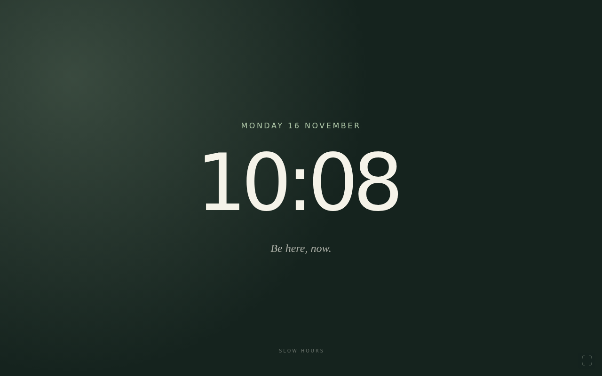
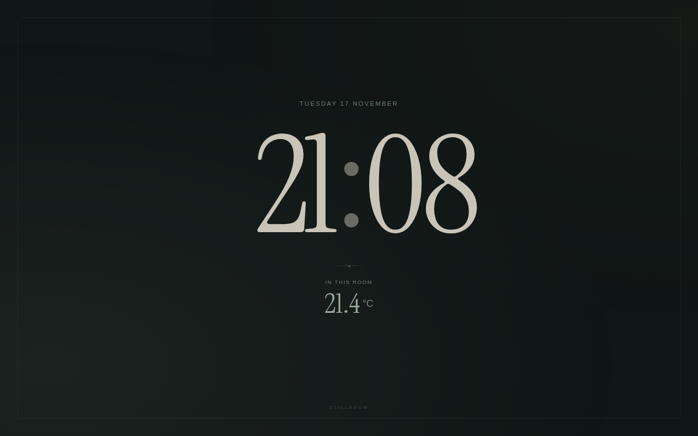

# screensvr

**A calmer idle screen for your smart home tablet.**

Turn an unused dashboard into a quiet clock, a photo frame, or a glance at the
weather and your next appointment. screensvr is a self-hosted web app designed
for **[Fully Kiosk Browser](https://www.fully-kiosk.com/)**, and works in other
modern browsers too.

Run it on your home server, give each display its own link, and manage everything
from one web interface. No screensvr cloud account or subscription is needed.


## What you can do

- **Choose your atmosphere.** Eight included designs, called **faces**, cover
  digital and analog clocks, gentle gradients, photos, weather, and calendars.
- **Manage every display in one place.** Give each screen its own face, settings,
  and timezone. Preview changes before saving; connected screens update automatically.
- **Let the day set the scene.** Save different looks and switch between them on
  a weekly schedule: photos by day, a quiet clock in the evening, and a dim night clock.
- **Bring your photos.** Play an Immich album or a slideshow from a read-only
  local/NAS photo folder, with an optional clock.
- **Connect useful details.** Show Home Assistant temperatures and weather, or
  your next appointment from Home Assistant calendars and iCalendar feeds.
  Calendar titles are private unless you explicitly choose to publish them.
- **Make it your own.** Install custom face ZIPs without rebuilding the server,
  or build a face with ordinary HTML, CSS, and JavaScript.

## Quick start

You need a server reachable from your tablet and **Docker with Docker Compose**.
Published images support **Linux amd64**. For ARM or a Node.js installation,
see [other installation options](docs/deployment.md#other-installation-options).

### 1. Start screensvr

Create a directory and save this as `compose.yaml`:

```yaml
services:
  screensvr:
    image: ghcr.io/lemanjo/screensvr:v1.0.0
    ports:
      - "3000:3000"
    volumes:
      - screensvr-data:/data
    restart: unless-stopped
    init: true
    security_opt:
      - no-new-privileges:true
    cap_drop:
      - ALL

volumes:
  screensvr-data:
```

Then run from that directory:

```sh
docker compose up -d
```

This example targets **1.0.0**; its image is available after the release workflow
successfully publishes it. Check [releases](https://github.com/lemanjo/screensvr/releases)
for published versions.

### 2. Create your first display

1. Open **`http://YOUR_SERVER_IP:3000`** in a browser.
2. Create an administrator password with at least 12 characters.
3. Choose **Add display**, give it a name such as **Living room**, and pick a face.
4. Copy its **Display URL**, for example
   `http://YOUR_SERVER_IP:3000/display/living-room`.

Use your server's network address in the tablet's link, not `localhost`. The
display does not need an administrator login, and its link stays the same if
you rename it. Retrieve it later with **Display link**.

> **Set up on a trusted network.** The first person to complete setup becomes the
> administrator. Anyone who can reach the server can view display links and their
> selected data, including photos and published appointments. Management requires
> your password. See [secure deployment](docs/deployment.md#reverse-proxies)
> before making the server reachable outside your home.

### 3. Set up Fully Kiosk

Keep your usual dashboard as Fully Kiosk's **Start URL**. On the tablet:

1. Open **Settings → Screensaver**.
2. Set **Screensaver Wallpaper URL** to your screensvr display link.
3. Set **Screensaver Timer** to your preferred idle time, such as 60 seconds.
4. Leave **Screensaver Playlist** empty to use only the screensvr page.

Fully Kiosk's screensaver feature requires **Fully PLUS**. Fully Kiosk controls
idle activation, returning to your dashboard, hardware brightness, and screen
power—not screensvr. See the
[Fully Kiosk screensaver settings](https://www.fully-kiosk.com/docs/en/configuration/screensaver).

You can also open the display link in another modern browser and use fullscreen
mode on a tablet or monitor.

**Keep your data:** The `screensvr-data` volume holds your settings, installed
faces, and encrypted integration credentials. Preserve it when upgrading.
See [upgrades and backups](docs/deployment.md#upgrading).

## Find your face

All eight faces are included. Clocks work without an integration; connect a data
source when you want photos, sensor readings, weather, or appointments.

| Face                  | A good fit for                                                                                  |
| --------------------- | ----------------------------------------------------------------------------------------------- |
| **Slow Hours**        | A quiet digital clock, a short reminder, optional room temperature, and a dedicated night mode. |
| **Soft Orbit**        | A simple analog clock with a warm, paper-like finish.                                           |
| **Color Drift**       | A numberless analog clock over a slowly moving pastel gradient.                                 |
| **Color Drift Night** | A darker gradient clock in indigo, plum, and teal.                                              |
| **Stillroom**         | Warm serif clock numerals and a subtle room-temperature reading.                                |
| **Photo Hours**       | A favorite photo or a rotating collection, with shuffle, fill/fit, and an optional clock.       |
| **Weather Hours**     | Current weather, a short daily or hourly forecast, and gentle weather-aware animation.          |
| **Calendar Hours**    | One upcoming or ongoing appointment, with busy-only privacy by default.                         |

| Slow Hours                                                                         | Soft Orbit                                                                                |
| ---------------------------------------------------------------------------------- | ----------------------------------------------------------------------------------------- |
|  |                |
| **Color Drift**                                                                    | **Color Drift Night**                                                                     |
|     |  |



## Make it part of your day

### Save scenes and schedule a night clock

Open a display's **Scenes & schedule** to save looks with their own face,
settings, and data sources. Use **Add night clock** for a near-black Slow Hours
scene, then schedule it alongside your daytime look. Schedules follow the
display's timezone.

See [scenes and scheduling](docs/user-guide.md#scenes-and-scheduling) for a
step-by-step example. Night mode dims the page, not the tablet's backlight.

### Connect photos, weather, and calendars

Open **Integrations** to add a connection, then choose what to show under a
display or scene's **Data sources**. Trying a selection changes only the preview;
saving an active scene updates the screen.

| Source              | What you can show                                               | Setup                                                               |
| ------------------- | --------------------------------------------------------------- | ------------------------------------------------------------------- |
| Home Assistant      | Sensors, current weather, forecasts, and calendars              | [Home Assistant](docs/integrations.md#home-assistant)               |
| Immich              | An owned or shared album; requires Immich 3.4.1 or later in 3.x | [Immich](docs/integrations.md#immich)                               |
| Local or NAS folder | A photo slideshow or one selected image                         | [Mounted photo folders](docs/integrations.md#mounted-photo-folders) |
| iCalendar feed      | Your next appointment from a read-only subscription             | [Calendars](docs/integrations.md#calendars)                         |

Credentials stay on the server. Faces receive only the data you select, never
your integration tokens. Selected content has the same visibility as the display
link; see [integration privacy](docs/integrations.md#privacy-and-credentials).

### Install or build a face

Choose **Face library → Install a face** and select a face ZIP. Only install
packages from sources you trust: faces run JavaScript, and sandboxing does not
make hostile packages safe.

To build your own, start with the [face developer guide](docs/faces.md) and the
[framework-free Paper example](examples/paper/).

## Documentation

- [User guide](docs/user-guide.md): displays, scenes, schedules, and everyday troubleshooting.
- [Deployment](docs/deployment.md): installation alternatives, HTTPS, upgrades, and backups.
- [Integrations](docs/integrations.md): connect your services and choose what to publish.
- [Building faces](docs/faces.md): manifest, settings, inputs, SDK, and packaging.
- [Development](docs/development.md): local setup, Dev Container, and tests.
- [Architecture](docs/architecture.md) · [Releasing](docs/releasing.md) · [Security policy](SECURITY.md)

## License

Licensed under the [MIT License](LICENSE).

Stillroom's bundled Instrument Serif font is distributed under the
[SIL Open Font License 1.1](faces/builtin-stillroom/assets/OFL.txt).
