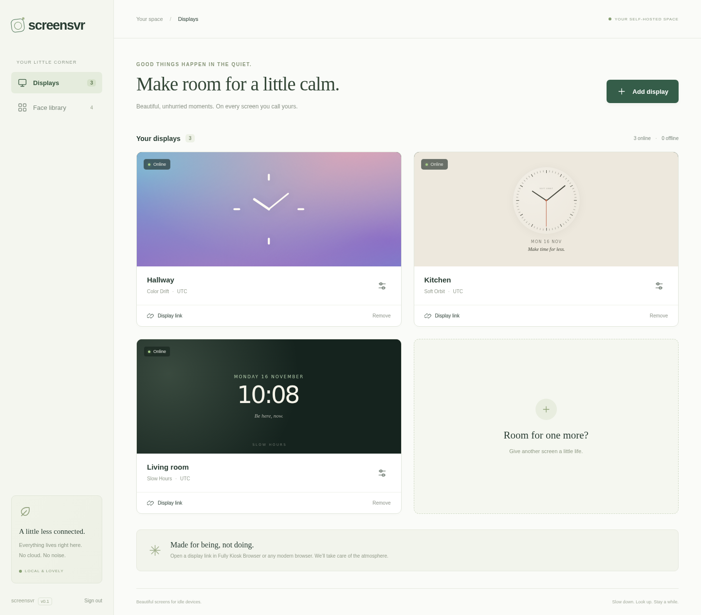
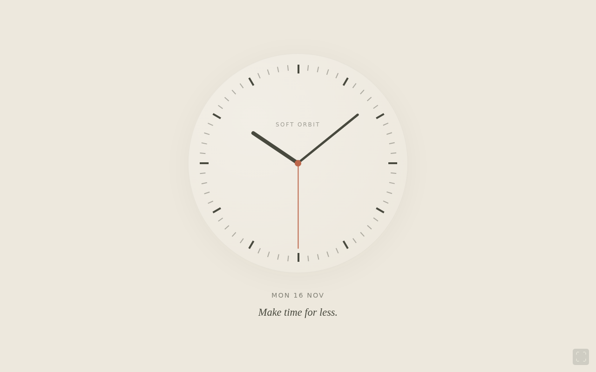
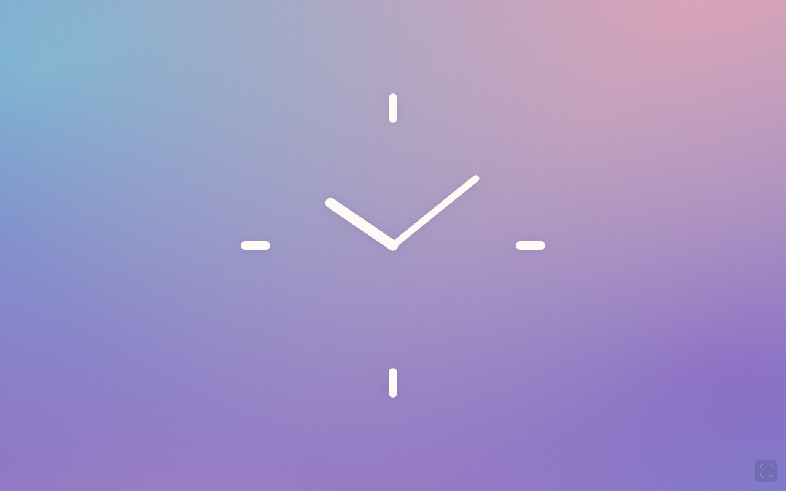
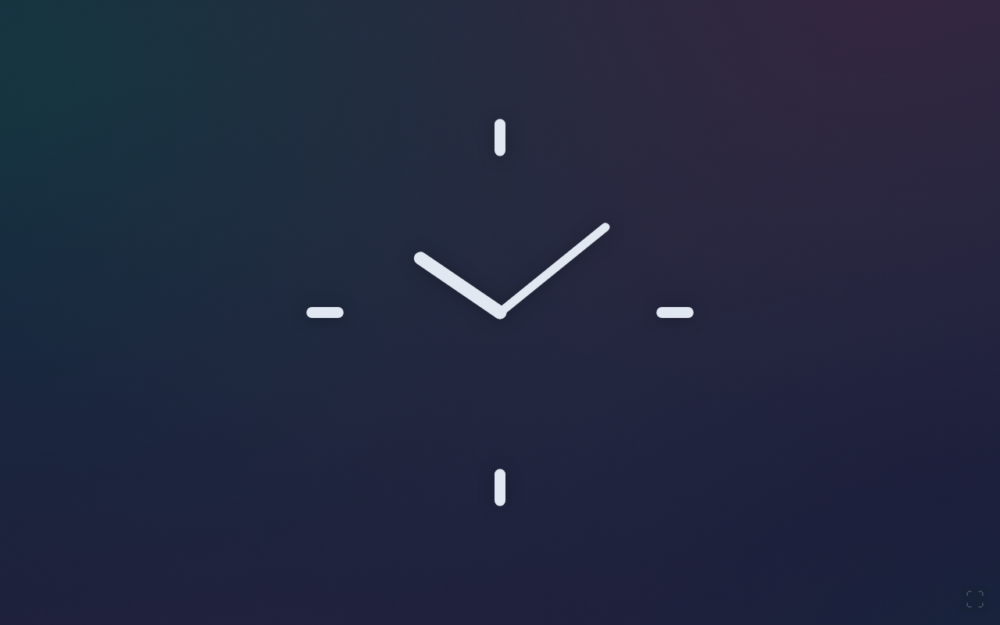
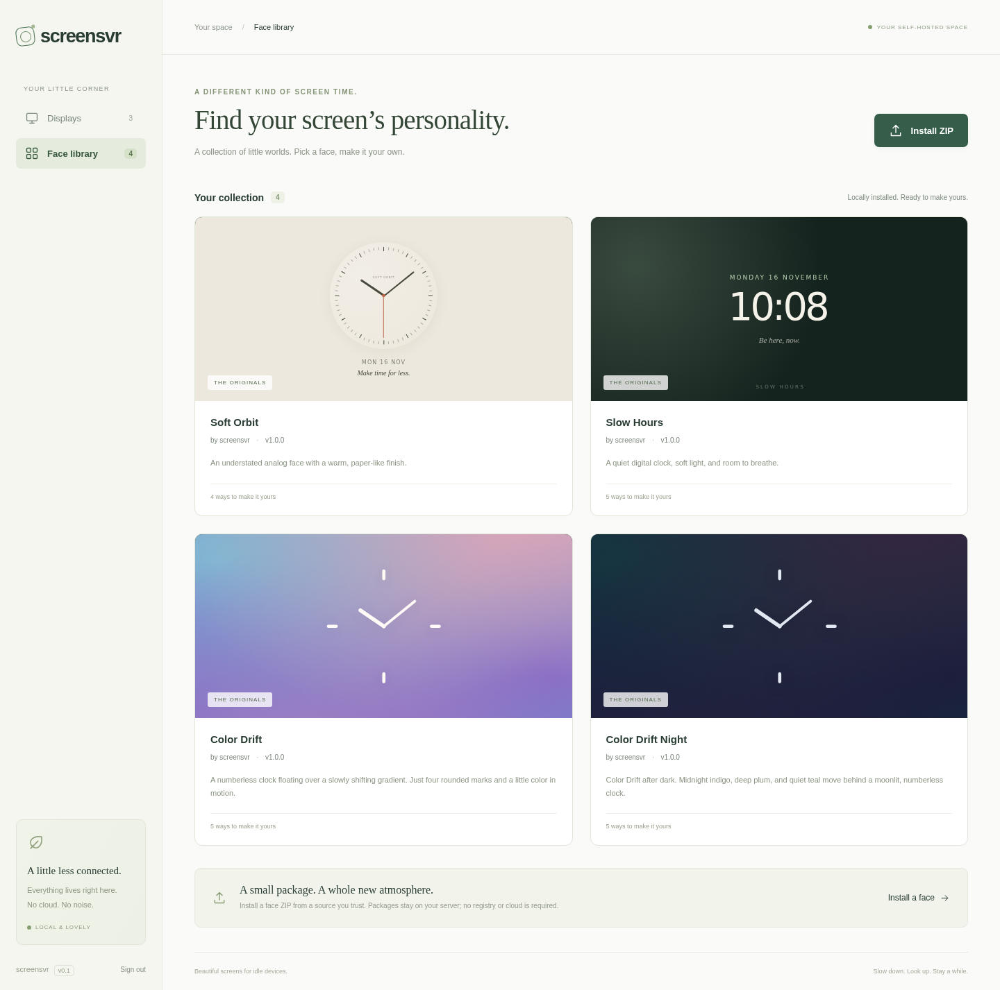

# screensvr

**A screensaver for your wall-mounted smart home tablet.**

screensvr is a self-hosted web app that gives your home automation tablet
something beautiful to show when it is not in use. Instead of leaving your
dashboard on screen all day, show a simple clock, soft colors, and gentle
animation.

It is designed for **[Fully Kiosk Browser](https://www.fully-kiosk.com/)**, which
can open a web page as a screensaver. Keep Home Assistant or another dashboard as
your normal page, and use screensvr when the tablet is idle. Fully Kiosk handles
when the screensaver starts and when to return to your dashboard.

Run screensvr on a server in your home network, then manage all your displays
from one web interface. Each display has its own link and a choice of customizable
designs, called **screen faces**. Preview a face, adjust its settings, and save:
connected displays update automatically. Your settings and installed faces stay
on your server, with no cloud account needed.



## Deployment

Choose one of the following options. All three run the app on port **3000**.

### Use the prebuilt container (recommended)

Requires Docker with Docker Compose. Create a directory for screensvr and save
the following as `compose.yaml` inside it:

```yaml
services:
  screensvr:
    image: ghcr.io/lemanjo/screensvr:v0.1.0
    ports:
      - "3000:3000"
    volumes:
      - screensvr-data:/data
    restart: unless-stopped
    init: true
    security_opt:
      - no-new-privileges:true
    cap_drop:
      - ALL

volumes:
  screensvr-data:
```

From that directory, start the app:

```sh
docker compose up -d
```

Images are published to GitHub Container Registry (GHCR). The example pins
**v0.1.0**; see [releases](https://github.com/lemanjo/screensvr/releases) for
available versions. Published images currently support **Linux amd64**. For ARM
servers, build the container from source using the next option.

### Build the container locally

Requires Git and Docker with Docker Compose. Clone the source and build it on
your server:

```sh
git clone https://github.com/lemanjo/screensvr.git
cd screensvr
docker compose up --build -d
```

The repository includes a `compose.yaml`, so no extra configuration is needed.

### Run locally with Node.js

Requires Git and **Node.js 24 LTS**. No Docker is needed.

```sh
git clone https://github.com/lemanjo/screensvr.git
cd screensvr
npm ci
npm run build
npm start
```

**Keep your data:** Both container options store settings, authentication, and
installed faces in the `screensvr-data` volume. Node.js uses the `data/` directory
by default. Keep this storage when upgrading. See
[deployment and backups](docs/deployment.md) for environment variables, HTTPS,
backups, and container image verification.

## Set up your tablet

1. Open `http://YOUR_SERVER_IP:3000` in a browser. If you are on the server itself,
   you can use **http://localhost:3000**.
2. Create an administrator password with at least 12 characters.
3. Choose **Add display**, give it a name such as **Living room**, and pick a face.
4. Copy its **Display URL**, for example
   `http://YOUR_SERVER_IP:3000/display/living-room`.

Use your server's network IP address or hostname in the tablet's link, not
`localhost`. You can retrieve the link later with **Display link**. It stays the
same even if you rename the display, and the tablet does not need an
administrator login.

### Schedule scenes

Open a display's **Scenes & schedule** to save different looks. Each scene keeps
its own face, settings, and data sources. Creating or editing an inactive scene
does not change the live screen; switching back restores its saved selections.
Scenes belong to one display, not a shared library.

Under **Weekly schedule**, choose weekdays, a start time, and a scene. For example:

| Days      | Start | Scene          |
| --------- | ----- | -------------- |
| Mon–Fri   | 07:00 | Daytime photos |
| Sat–Sun   | 09:00 | Daytime photos |
| Every day | 19:00 | Evening clock  |
| Every day | 23:00 | Night clock    |

Times use the display's timezone. A scene stays active until the next entry,
including overnight and on days without entries. Enabling a schedule immediately
selects the current scene. Disable scheduling before manually activating a scene;
disabling keeps the scene currently on screen. Existing displays start with a
**Default** scene and scheduling disabled.

**Add night clock** creates a Slow Hours scene with a black background, dim
numerals, and no glow, seconds, or decorative content. This changes the rendered
page, not the tablet's backlight. Configure hardware brightness and screen power
in Fully Kiosk or on the device.

During daylight-saving spring-forward gaps, skipped entries apply at the clock
jump, with the latest skipped start winning. During a repeated autumn hour,
entries apply at their first occurrence only. Scheduling runs on the server:
connected screens update automatically, and sleeping or disconnected screens
resynchronize when they reconnect. A disconnected screen keeps its current face;
offline scheduling and offline cold starts are not supported.

### Use it as a Fully Kiosk screensaver

On your tablet, keep your usual dashboard as Fully Kiosk's **Start URL**. Then:

1. Open Fully Kiosk's **Settings → Screensaver**.
2. Set **Screensaver Wallpaper URL** to the display link you copied.
3. Set **Screensaver Timer** to your preferred idle time, for example 60 seconds.
4. Leave **Screensaver Playlist** empty if you only want the screensvr page.

The screensaver feature requires **Fully PLUS**. See the
[Fully Kiosk screensaver settings](https://www.fully-kiosk.com/docs/en/configuration/screensaver)
for brightness, motion detection, and other options.

You can also open a display link in any modern browser and use fullscreen mode
on a tablet or monitor. Automatic screensaver activation is handled by your
kiosk app, not by screensvr.

> **Keep it on a trusted network.** Anyone who can reach the server can view its
> display links; management requires the administrator password. Complete
> first-run setup on your trusted network, since the first person to finish setup
> claims the server. See the [deployment guide](docs/deployment.md#reverse-proxies)
> before exposing it outside your home.

## Included screen faces

Six faces are ready to use. These screenshots show the original clock designs.
Each face has its own options for colors, clock style, or animation.

| Slow Hours                                                                                    | Soft Orbit                                                                                                                  |
| --------------------------------------------------------------------------------------------- | --------------------------------------------------------------------------------------------------------------------------- |
|          |                               |
| A quiet digital clock with a short reminder.                                                  | A simple analog clock with a warm, paper-like finish.                                                                       |
| **Color Drift**                                                                               | **Color Drift Night**                                                                                                       |
|  |  |
| Soft colors and a slowly moving gradient.                                                     | A darker take on Color Drift for a quieter screen.                                                                          |

**Stillroom** pairs a locally bundled Instrument Serif digital clock with a
quiet room-temperature reading on a charcoal-green background. Its gentle
ambient movement respects reduced-motion preferences. Choose a Home Assistant
sensor under the display's **Data sources → Room temperature** settings.


**Photo Hours** shows a selected photo or a slideshow from a mounted directory
or an **Immich album**, with an optional clock. Choose its photos under the
display's **Data sources** settings. See [Immich setup](docs/integrations.md#immich)
or [mounted photo setup](docs/integrations.md#mounted-photo-folders) for the
optional read-only Docker/NAS mount.

## Add more faces

Open **Face library** to browse your collection. To add a face, choose **Install a
face** and select a face package. No server rebuild is needed.



Only install packages from sources you trust. Faces run JavaScript; the sandbox
adds protection but does not make untrusted code safe.

Want to build your own? Start with the [face developer guide](docs/faces.md) and
the [framework-free example](examples/paper/).

## Connect your home

Add a **Home Assistant** connection under **Integrations**, then select a sensor
in a display's **Data sources** settings. Slow Hours and Stillroom can show a room
temperature; other faces can declare numeric, humidity, boolean, or text inputs.
Faces receive only the selected readings through the SDK, never your credentials.

Connections are read-only and shared across displays, while each display chooses
its own sensors. See [integration setup and privacy](docs/integrations.md) and the
[Room Climate developer example](examples/room-climate/). Selected readings are
public to anyone who can reach the display URL, just like other display content.

For photos, add **Immich** under Integrations using your instance URL and a
read-only API key, then choose an owned/shared album in a display's photo data
sources. Requires Immich **3.4.1 or later in 3.x**. Credentials stay on the server;
the entire selected album has the same visibility as the display.

## Development

Open the repository using **Dev Containers: Reopen in Container** in VS Code for
the development toolchain, or use Node.js 24 LTS locally:

```sh
npm ci
npm run dev
```

Open **http://localhost:5173**. The development server forwards API and face
requests to the backend on port 3000. Do not use it for production.

To run checks:

```sh
npm run typecheck
npm run lint
npm test
npm run build
npm run test:e2e
```

Browser tests use Chromium, Firefox, and WebKit. Actual Fully Kiosk/Android
hardware still needs device testing. See the [development guide](docs/development.md)
for more details.

## License

Licensed under the [MIT License](LICENSE).

Stillroom's bundled Instrument Serif font is distributed under the
[SIL Open Font License 1.1](faces/builtin-stillroom/assets/OFL.txt).
